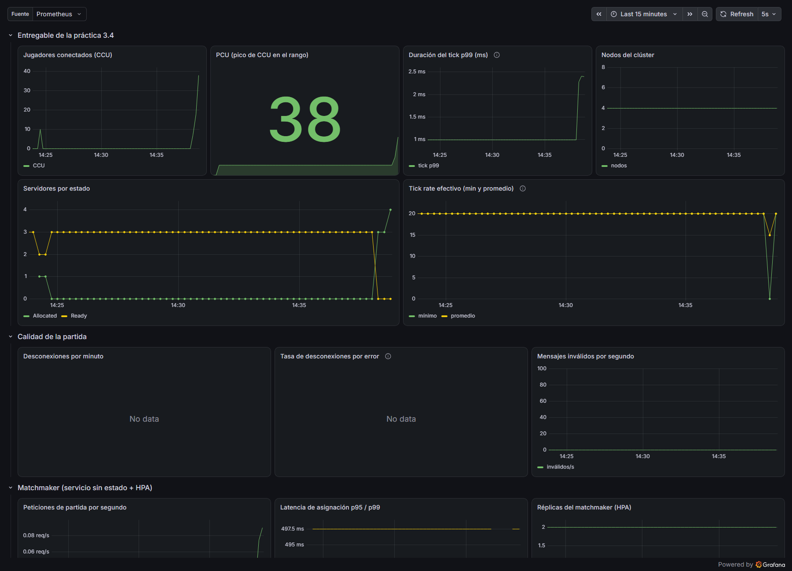
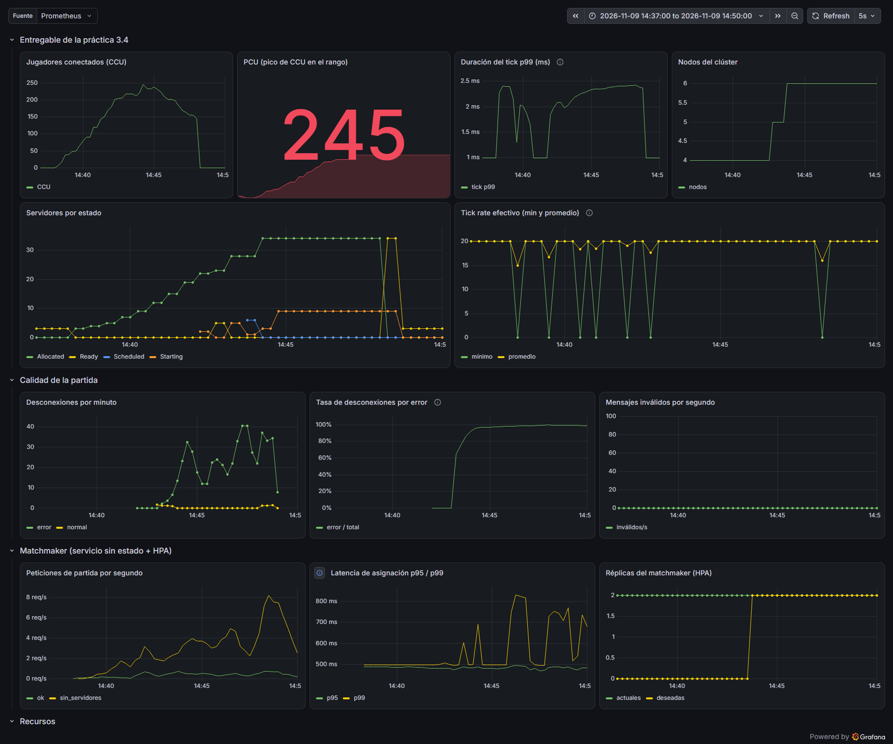
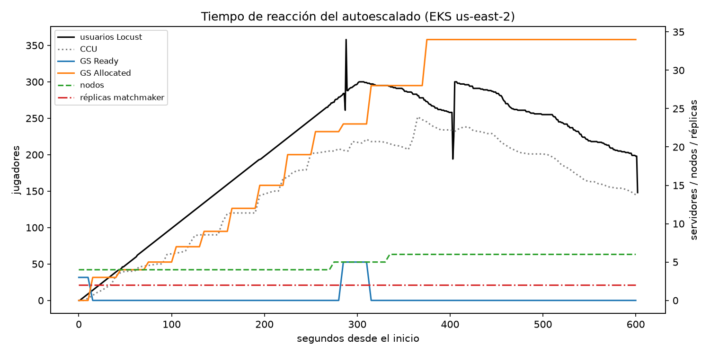
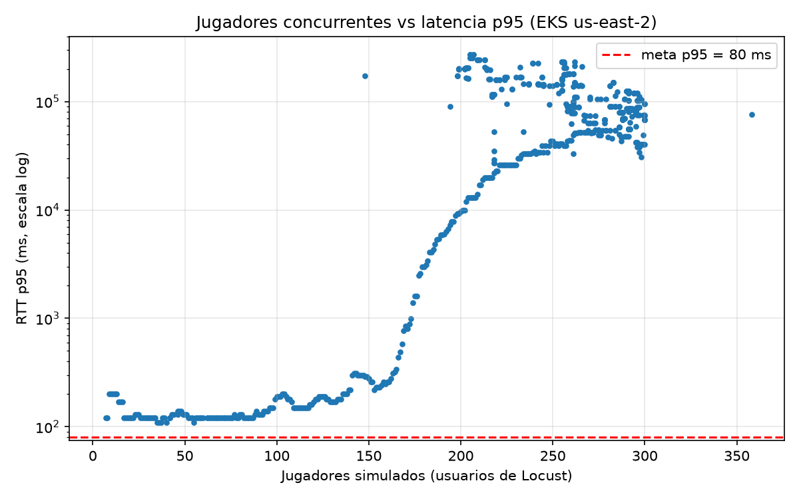
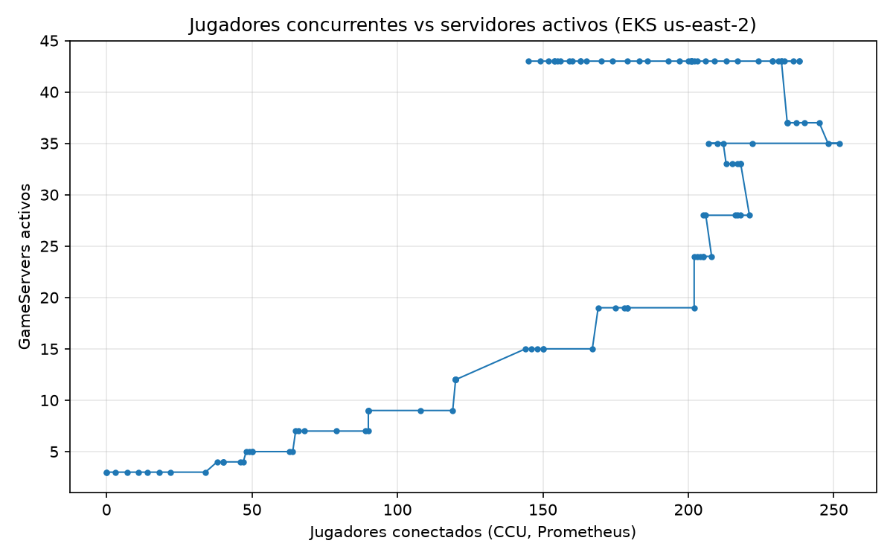

# Práctica 3.4 — Autoescalado, métricas y simulación de jugadores

**Equipo:** Jarom Cortes Perez y Carlos Antonio Vogel Romero · Instituto Tecnológico de Colima (TecNM) · Noviembre de 2026

**Objetivo:** generar carga realista contra la flota de la 3.3, observar el
autoescalado y obtener la curva latencia vs CCU.

## Entregado en AWS (2026-11-09)

Clúster EKS `nebula` en us-east-2 (nodos m7i-flex.large, mínimo 2 y máximo 6).
Rampa de **300 jugadores**, 1 jugador nuevo por segundo, 10 minutos. Locust corrió
en la laptop (Colima) con 1 maestro y 4 workers contra el matchmaker
(LoadBalancer de AWS).

```powershell
locust -f locustfile.py Jugador --master --expect-workers 4 --headless -u 300 -r 1 -t 10m --csv reports/rampa-aws --csv-full-history
python loadtest/analizar.py --prefijo rampa-aws --dir loadtest/reports --prometheus http://localhost:9090 --etiqueta "EKS us-east-2"
```

**Las tres capas escalaron solas:**

| Capa | Antes | Pico | Reacción |
|---|---|---|---|
| 1 — flota (FleetAutoscaler, buffer) | 3 servidores Ready | 37 servidores (34 en partida) | primer escalado a los 43 s |
| 2 — matchmaker (HPA por CPU) | 2 réplicas | 2 réplicas (CPU 2–3 % de 60 %) | no hizo falta escalar |
| 3 — nodos (Cluster Autoscaler) | 4 nodos | 6 nodos (el máximo) | 2→4, 4→5 y 5→6 por pods pendientes |

**Resultados** (`entrega/evidencias/3.4-autoescalado/resumen.json`):

| Métrica | Valor |
|---|---|
| CCU máximo (Prometheus) | 252 |
| Tick p99 del servidor | ≤ 2.5 ms (presupuesto: 50 ms) |
| Tick rate | 20 Hz sostenido |
| RTT con ≤ 164 jugadores | p50 120 ms, p95 320 ms |
| RTT con > 200 jugadores | p50 5–8 s, p95 > 12 s (ver hallazgos) |
| Asignaciones rechazadas (503, sin servidores) | 200 de 234 |

**Hallazgos:**

1. **El techo fue el máximo de nodos, no el código.** Con 6 nodos caben ~34 servidores (cada uno pide 250m de CPU), así que a partir de ~250 jugadores los servidores nuevos se quedaron `Pending` y el matchmaker respondió 503. Ese máximo de 6 se puso a propósito para no gastar los créditos. Para 1,000 jugadores harían falta unos 20 nodos.
2. **Los servidores nunca se saturaron.** El tick p99 se quedó en 2.5 ms (el 5 % de su presupuesto de 50 ms), el tick rate en 20 y la CPU máxima de un nodo en 74 %.
3. **La latencia se disparó a partir de ~200 jugadores, y la causa probable es el generador de carga.** Las peticiones por segundo de Locust bajaron de 55 a 7 mientras los usuarios seguían subiendo, y al mismo tiempo los servidores seguían en 20 Hz. Eso apunta a la laptop (4 procesos de Python con cientos de websockets por internet doméstico), no al clúster. **No está comprobado:** para confirmarlo hay que correr Locust dentro de AWS, cerca del clúster.
4. **La meta de p95 < 80 ms no se puede medir desde Colima.** El RTT base de Colima a Ohio es de ~106 ms antes de cualquier carga (primera partida, práctica 3.3).
5. **Faltaba metrics-server.** EKS no lo instala, y sin él el HPA mostraba `cpu: <unknown>`. Se agregó como complemento de EKS en `infra-aws/cluster.tf`.

**Evidencias** (`entrega/evidencias/3.4-autoescalado/`):











<!-- consola: ../entrega/evidencias/3.4-autoescalado/01-estado-durante-la-rampa.txt | 1-20,33-35 | Estado del clúster a mitad de la rampa: 6 nodos (el máximo), la flota en 37 servidores con 34 en partida, el HPA del matchmaker y los eventos del Cluster Autoscaler (2→4, 4→5 y 5→6 nodos). -->

**Pendiente:**

- Espectadores (500 por CDN): falta la parte de S3 + CloudFront.
- Pico 1×→10×.

| Pieza | Archivo | Estado |
|---|---|---|
| Capa 1 — flota (FleetAutoscaler, buffer 20 %) | `k8s/autoscaler.yaml` | Probado en kind |
| Capa 2 — servicio sin estado (matchmaker + HPA por CPU) | `matchmaking/`, `k8s/matchmaker.yaml` | Probado en kind (5 pruebas). El HPA no llegó a escalar: el matchmaker no pasó del 60 % de CPU |
| Capa 3 — nodos (Cluster Autoscaler) | `infra/modules/gke` | **Solo en GKE** (kind tiene un nodo fijo) |
| Prometheus + PodMonitor | `k8s/podmonitor.yaml` | Probado en kind |
| Dashboard de Grafana | `monitoring/grafana/nebula-dashboard.json` | Cargado en Grafana de kind (14 paneles) |
| Jugadores y espectadores simulados | `loadtest/locustfile.py` | Jugadores probados en kind; espectadores **pendiente** (necesita la CDN) |
| Gráficas y resumen | `loadtest/analizar.py` | Probado con las corridas locales |
| Rampa de 1,000, pico 1×→10×, 500 espectadores | — | **Pendiente: en GKE** |

## Lo que se agregó al material y por qué

- **Matchmaker real** (`matchmaking/matchmaker.py`). El material usa un `matchmaker` como ejemplo de HPA, pero el papel lo hace Locust. Para que la capa de "pods" escale de verdad hace falta un servicio sin estado real. Este recibe `POST /match`, crea una `GameServerAllocation` con la API de Kubernetes y devuelve IP y puerto. Su cuenta de servicio solo puede crear asignaciones (permisos mínimos). Además, Locust ya no necesita los certificados del allocator.
- **`locustfile.py`** es el del material, con estos agregados: puede usar el matchmaker (`MATCHMAKER_URL`) o el allocator con certificados (`ALLOCATOR_IP`, opción del material); reintenta la asignación cuando la flota aún no escala, contando cada fallo; registra las desconexiones, y mantiene a los jugadores dentro de la arena (el servidor valida las coordenadas).
- **Dashboard:** los cuatro paneles del entregable (CCU, tick p99, servidores por estado, nodos) más PCU, tick rate, desconexiones, matchmaker, réplicas del HPA, CPU y memoria. La latencia RTT, el jitter y la pérdida de paquetes los miden los clientes (Locust), no el servidor, así que salen de los CSV.

## Ensayo local en kind (no sustituye la prueba en GKE)

Clúster kind de **un nodo** dentro de Docker Desktop (12 hilos y ~4 GB de RAM para
Docker), con Agones, Prometheus, Grafana, metrics-server, el matchmaker y Locust,
todo en la misma laptop. Locust corre como contenedor en la red `kind` para
alcanzar las IPs de los GameServers. Las peticiones de recursos de los servidores
se bajaron a 50m/64Mi solo en `k8s/local/fleet-local.yaml`, porque 12 servidores
con 250m/256Mi no caben en el nodo.

```bash
docker build -t nebula-locust:1.0 loadtest
docker run --rm --network kind -e MATCHMAKER_URL=http://nebula-control-plane:30080 \
  -v "$PWD/loadtest/reports:/loadtest/reports" nebula-locust:1.0 \
  Jugador -u 120 -r 1 -t 6m --headless --csv reports/rampa-local-v1.2 --csv-full-history
kubectl port-forward -n monitoring svc/monitoreo-kube-prometheus-prometheus 9090:9090 &
python loadtest/analizar.py --prefijo rampa-local-v1.2 --dir loadtest/reports --etiqueta "kind local"
```

### Resultados (2026-11-05)

Misma rampa en las dos corridas: 0 → 120 jugadores, 1 por segundo, 6 minutos.

| | Corrida 1: servidor 1.1 | Corrida 2: servidor 1.2 |
|---|---|---|
| Servidores vivos (máx.) | 3 (+1 atorado en `Scheduled`) | **13** |
| Pico de jugadores conectados (CCU, Prometheus) | 30 | **70** |
| Asignaciones pedidas / fallidas | 35 / 31 | 28 / 21 |
| Desconexiones durante la partida | 24 | 70 |
| RTT p50 / p95 / p99 | 8 / 37 / 600 ms | 16 / 390 / 11,000 ms |
| Primer escalado de la flota | nunca | 74 s después de llegar la carga |
| Tiempo con 0 servidores `Ready` | 27 % | 74 % |

Datos y gráficas en `loadtest/reports/rampa-local-v1.1/` y `rampa-local-v1.2/`
(`resumen.json`, `ccu_vs_p95.png`, `ccu_vs_servidores.png`,
`reaccion_autoescalado.png` y los CSV de Prometheus).

### Hallazgo 1: un servidor podía quedarse en `Scheduled` para siempre (corregido en 1.2)

El servidor del material llama a `/ready` **una sola vez** al arrancar. El
contenedor del juego y el sidecar del SDK de Agones arrancan en paralelo, y con el
nodo cargado el sidecar tardó **63 s** en levantar (logs: el juego a las 02:07:07,
el SDK a las 02:08:10). La llamada falló en silencio y el GameServer nunca pasó a
`Ready`. El FleetAutoscaler lo contaba como parte de la flota, así que **no creaba
más servidores**: en la corrida 1 la flota se quedó en 3 partidas (30 jugadores)
mientras Locust pedía 120.

La versión 1.2 reintenta `/ready` cada segundo hasta que el sidecar responde (con
su prueba unitaria). En cuanto se aplicó, 2 de los 3 servidores nuevos
necesitaron el segundo intento: la carrera ocurre casi siempre, no solo con carga.
Con 1.2 la flota llegó a 13 servidores.

### Hallazgo 2: el límite del nodo local está alrededor de 60–70 jugadores

En la corrida 2 aparecieron **127 eventos `Health check failure`**. Con todo en un
nodo, la CPU no alcanzó para que los servidores enviaran su `/health` a tiempo.
Agones los dio por muertos y **borró servidores con partida en curso** (de ahí las
70 desconexiones), y hasta el matchmaker falló sus `readinessProbe` por timeout.
El cuello de botella ya no es el código, es el nodo único. En GKE, esa misma
saturación deja pods pendientes que disparan el Cluster Autoscaler (capa 3), cosa
que kind no tiene.

Conclusión del ensayo: **un nodo local sostiene unos 60–70 jugadores** antes de
degradarse (CCU máximo de 70 con el p95 ya arriba de 80 ms). No es la capacidad de
un nodo de GKE: allí no estarían Prometheus, Grafana y Locust compitiendo por la
misma CPU.

### Hallazgo 3: el buffer de 20 % no alcanza con arranques lentos

En la corrida 2 la flota pasó el **74 % del tiempo sin servidores `Ready`**. Con
la rampa de 1 jugador/s se necesita un servidor nuevo cada 10 s, y cada uno tardó
hasta un minuto en estar listo. El FleetAutoscaler, además, recalcula cada 30 s
por defecto. A probar en GKE, con datos:

- Subir el `bufferSize` o el `minReplicas` cuando se espera un pico (escalado programado).
- Bajar el intervalo de sincronización del FleetAutoscaler (`spec.sync.fixedInterval.seconds`, 30 por defecto).
- Medir cuánto tarda un servidor en llegar a `Ready` en un nodo de GKE sin carga extra.

## Pendiente en GKE (comandos del material)

1. Generador de carga en una VM de la misma región (no desde la casa):

   ```bash
   gcloud compute instances create locust-gen --zone us-central1-a --machine-type e2-standard-8
   gcloud compute scp loadtest/locustfile.py locust-gen:~ --zone us-central1-a
   ```

2. Monitoreo: los mismos `helm install` que en kind (ver la sección de monitoreo de la 3.4 en el material) y `kubectl apply -f k8s/podmonitor.yaml`. El dashboard se importa en Grafana desde `monitoring/grafana/nebula-dashboard.json` (*Dashboards → Import*).
3. Escenarios:

   ```bash
   export MATCHMAKER_URL=http://<EXTERNAL-IP de svc/matchmaker>
   locust -f locustfile.py Jugador -u 1000 -r 2  -t 20m --headless --processes -1 --csv rampa --csv-full-history
   locust -f locustfile.py Jugador -u 1000 -r 50 -t 10m --headless --processes -1 --csv pico  --csv-full-history
   ```

   El "pico de 1× a 10× en un minuto" del proyecto: arranca con `-u 100` estable y sube a 1,000 en 60 s (`-r 15`). Se puede hacer desde la interfaz web de Locust o con un `LoadTestShape`.
4. Espectadores: video HLS de 5 min a 360p con `ffmpeg`, subido a un bucket con Cloud CDN (comandos del material), y luego:

   ```bash
   locust -f locustfile.py Espectador --host http://<IP-CDN> -u 500 -r 50 -t 5m --headless --processes -1 --csv stream
   ```

5. `python analizar.py --prefijo rampa` (y `pico`) con Prometheus en `localhost:9090`.

Cuota necesaria: 1,000 jugadores = 100 partidas + buffer ≈ 120 servidores × 0.25
vCPU ≈ 30 vCPU → 9–10 nodos `e2-standard-4`. Supera las 8 vCPU de la prueba
gratuita: hay que activar la cuenta completa (los créditos se conservan).

## Extrapolación de espectadores (cálculo, no medición)

Fórmula del material: `GB/hora = CCV × bitrate (kbps) × 3600 / (8 × 10⁶)`.

| Escenario | Cálculo | Resultado |
|---|---|---|
| Prueba: 500 espectadores a 360p (800 kbps), 5 min | 500 × 800 × 300 / 8×10⁶ | 15 GB (400 Mbps sostenidos) |
| Extrapolación: 20,000 espectadores a 1080p (6,000 kbps), 1 hora | 20,000 × 6,000 × 3,600 / 8×10⁶ | **54,000 GB ≈ 54 TB por hora** (120 Gbps) |

El costo en dólares sale de multiplicar esos GB por la tarifa de egress de Cloud
CDN para Norteamérica en la calculadora oficial. *Pendiente*: no se anota un
precio sin consultarlo.
