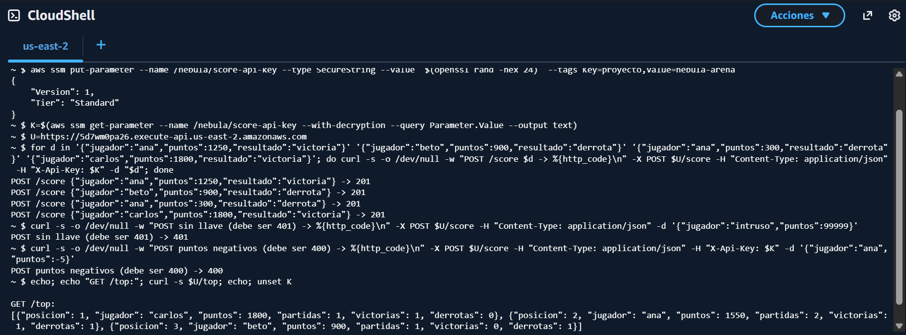

# Práctica 3.5 — Tabla de líderes serverless

**Equipo:** Jarom Cortes Perez y Carlos Antonio Vogel Romero · Instituto Tecnológico de Colima (TecNM) · Noviembre de 2026

**Objetivo:** recibir el resultado de cada partida y mantener el top 10 global sin
administrar servidores.

> **Se entregó con la opción AWS del material:** Lambda + API Gateway + DynamoDB,
> desplegada y probada el 2026-11-09. La versión de Google Cloud (Cloud Run +
> Firestore) queda en el repositorio como alternativa equivalente y se describe
> después de la sección de AWS.

## Opción AWS (desplegada)

| Paso | Estado | Evidencia |
|---|---|---|
| Código (`serverless/aws/lambda_function.py`) y pruebas | Hecho: 20 pruebas pasan, con los mismos casos que la versión de Cloud Run | `serverless/aws/tests/` |
| Infraestructura con Terraform (`infra-aws/tabla_lideres.tf`) | Hecho: 13 recursos | `entrega/evidencias/3.5-tabla-lideres/01`, `02`, `05` |
| URL pública funcionando (curl del material) | Hecho: 4 partidas → 201, sin llave → 401, puntos negativos → 400 | `03-prueba-cloudshell.png`, `04-lecturas-desde-pc.txt` |
| Prueba de carga 80/20 con 500 usuarios | Hecha dos veces, antes y después de una mejora | `06-carga-antes_*`, `07-carga-despues_*` |
| Comparación de costo serverless vs VM | Hecha (abajo) | — |



<!-- consola: ../entrega/evidencias/3.5-tabla-lideres/02-terraform-apply.txt | 314-319 | Final del terraform apply de la tabla de líderes: 13 recursos creados y la URL pública. -->

<!-- consola: ../entrega/evidencias/3.5-tabla-lideres/04-lecturas-desde-pc.txt | todo | Lecturas desde la PC, fuera de AWS: GET /top, GET /jugador/ana y los tiempos de 20 lecturas. -->

### Arquitectura

```
cliente / servidor de juego ──HTTPS──> API Gateway (HTTP API, límite 1000 req/s)
                                           │  POST /score · GET /top · GET /jugador/{id} · GET /healthz
                                           ▼
                                   Lambda nebula-leaderboard (Python 3.12, 256 MB)
                                           │  UpdateItem (ADD) · GetItem · Scan
                                           ▼
                                   DynamoDB nebula-scores (llave: jugador, PAY_PER_REQUEST)
```

- **Misma API que la versión de Cloud Run.** El servidor de juego (`LEADERBOARD_URL`), el cliente (`?leaderboard=`) y Locust funcionan sin cambios.
- **Sumas atómicas:** `UpdateItem` con `ADD puntos :p, partidas :uno`, como en el material. Dos partidas que terminan al mismo tiempo no se pisan.
- **Escrituras protegidas:** `POST /score` exige `X-Api-Key`. La llave es un parámetro **SecureString de SSM** que se crea fuera de Terraform (`infra-aws/crear-llave.ps1`, o en CloudShell). Así no queda ni en el código ni en el estado. La Lambda solo conoce el *nombre* del parámetro.
- **Mínimo privilegio:** el rol de la Lambda solo puede escribir sus logs, hacer `UpdateItem`, `GetItem` y `Scan` en *su* tabla, y leer *su* parámetro (ver `05-recursos-aws.txt`).
- **Protección del crédito:** límite de peticiones en API Gateway, logs con 7 días de retención y cobro por uso. Sin tráfico, el costo es prácticamente cero.

### Prueba de carga: hallazgo y mejora

`locust_leaderboard.py`, con 500 usuarios, 25 nuevos por segundo, 5 minutos, 80 % `GET /top` y 20 % `POST /score`, lanzado desde la PC:

| | Antes | Después |
|---|---|---|
| Peticiones enviadas | 132,673 (~443/s) | 133,367 (~446/s) |
| **Atendidas con éxito** | **10,503 (~35/s)** | **29,786 (~99/s)** |
| Errores `429` (límite de API Gateway) | 102,607 | **0** |
| Errores `503` (Lambda sin capacidad) | 19,563 | 103,581 |
| Duración promedio de la Lambda | 50 ms | **13 ms** (p50 = 2 ms) |
| Concurrencia máxima de la Lambda | 10 | 10 |
| Latencia de cliente p50 / p95 / p99 | 75 / 130 / 260 ms | 77 / 110 / 210 ms |

<!-- consola: ../entrega/evidencias/3.5-tabla-lideres/06-carga-antes_cloudwatch.txt | todo | Métrica de concurrencia de la Lambda en CloudWatch durante la prueba, ANTES de la mejora: la concurrencia máxima se quedó en 10, el límite de la cuenta. -->

<!-- consola: ../entrega/evidencias/3.5-tabla-lideres/07-carga-despues_cloudwatch.txt | todo | Las mismas métricas DESPUÉS de la mejora (caché de 2 s y límite de 1000 req/s), con el resumen de Locust. -->

**Qué pasó:**

1. Cada `GET /top` hacía un `scan` completo, de unos 50 ms. La cuenta nueva solo permite **10 ejecuciones de Lambda a la vez** (`ConcurrentExecutions` = 10 en Service Quotas), así que con ~440 req/s la mayoría se rechazaba.
2. Además, el límite de API Gateway que puse (100 req/s) rechazaba otra parte con `429`.

**Mejora aplicada:**

- **Caché del top de 2 segundos** en memoria de cada contenedor. Un top con 2 s de retraso es aceptable para una tabla de líderes.
- **Límite de API Gateway subido a 1000 req/s.**

Con eso, la duración bajó de 50 a 13 ms, desaparecieron los `429` y lo atendido se **triplicó**.

**Cuello de botella restante:** la cuota de concurrencia (10) de la cuenta nueva. No es un problema del diseño. El valor normal de AWS es 1000 y se pide en *Service Quotas → AWS Lambda → Concurrent executions*. Para producción también conviene un índice ordenado por puntos, o Redis con *sorted sets*, en lugar de `scan`, como recomienda el material.

**Arranque en frío:** la duración máxima fue de 3.5 s en la primera prueba, cuando se crearon contenedores nuevos. En la PC, la primera lectura tardó 149 ms y la mediana 125 ms (`04-lecturas-desde-pc.txt`).

### Costo serverless vs VM (escenario del material: 5 millones de consultas al mes)

Precios de lista de AWS consultados el 2026-11-09. Las páginas dan los ejemplos con N. Virginia; Ohio usa las mismas tarifas para estos servicios. Hay que confirmarlo en la calculadora oficial.

| Concepto | Cálculo | USD/mes |
|---|---|---|
| Lambda: peticiones | 5 M − 1 M gratis = 4 M × 0.20 / M | 0.80 |
| Lambda: cómputo | 5 M × 0.013 s × 0.25 GB = 16,250 GB-s (gratis hasta 400,000) | 0.00 |
| API Gateway HTTP | 5 M × 1.00 / M (1 M gratis los primeros 12 meses) | 4.00 – 5.00 |
| DynamoDB escrituras | 20 % = 1 M × 0.625 / M | 0.63 |
| DynamoDB lecturas | con la caché, ≤ 1 `scan` por contenedor cada 2 s | < 1 |
| **Total serverless** | | **≈ 6 – 7** |
| VM equivalente encendida 24/7 | una instancia pequeña, más su IP pública y disco | ≈ 15 – 20 |

Sin tráfico, la opción serverless cuesta casi **cero**, porque solo se paga lo que se usa. La VM cuesta lo mismo aunque nadie juegue.


## Opción Google Cloud (alternativa, no desplegada)

| Paso | Estado |
|---|---|
| Código (`serverless/main.py`) y pruebas | Hecho: 16 pruebas pasan |
| Imagen del contenedor | Se construye (289 MB) y gunicorn arranca; la respuesta HTTP del contenedor no se pudo comprobar en local con Docker saturado por el clúster kind |
| Despliegue en Cloud Run, URL funcionando | **Pendiente: necesita la cuenta de Google Cloud** |
| Prueba de carga 80/20 hasta 500 usuarios | Script listo (`loadtest/locust_leaderboard.py`); **pendiente** de correr contra Cloud Run |
| Comparación de costo serverless vs VM | **Pendiente:** con la calculadora oficial |

## API

Mismos endpoints y misma colección (`scores`) que el ejemplo del material, con
los campos que pide la tabla del proyecto:

| Método | Ruta | Qué hace |
|---|---|---|
| `POST` | `/score` | `{"jugador": "ana", "puntos": 1250, "resultado": "victoria"}`. Suma puntos y partidas. `resultado` es opcional (`victoria` o `derrota`), así que el `curl` del material funciona igual |
| `GET` | `/top` | Top 10: `posicion`, `jugador`, `puntos`, `partidas`, `victorias`, `derrotas` |
| `GET` | `/jugador/<id>` | Estadísticas de un jugador |
| `GET` | `/healthz` | Salud |

Agregados sobre el ejemplo del material:

- **Validación de entradas:** id de 1–32 caracteres (`A-Z a-z 0-9 _ -`) y puntos enteros entre 0 y 100,000. Los errores responden `400` con un mensaje.
- **Escrituras protegidas:** si la variable `SCORE_API_KEY` existe, `POST /score` exige la cabecera `X-Api-Key` (comparación en tiempo constante). La llave vive en Secret Manager (Terraform crea el secreto vacío) y se monta como variable de entorno. Leer `/top` es público.
- **Errores:** las excepciones no controladas se registran en el log y responden `500` sin filtrar detalles.

## Pruebas

```bash
cd serverless
../.venv/Scripts/python -m pip install -r requirements-dev.txt
../.venv/Scripts/python -m pytest -q          # 16 passed
```

Usan un Firestore falso en memoria que imita `set(merge=True)` con
`firestore.Increment`, `order_by().limit().stream()` y `get()`. Cubren el top
ordenado y limitado a 10, el conteo de victorias y derrotas, el formato del
material sin `resultado`, 10 casos de entrada inválida y la llave de API.

## Despliegue (pendiente)

Con los comandos del material, más la cuenta de servicio y el secreto que crea
Terraform (o créalos a mano):

```bash
gcloud services enable run.googleapis.com firestore.googleapis.com cloudbuild.googleapis.com
gcloud firestore databases create --location=nam5          # si no usaste Terraform
gcloud run deploy nebula-leaderboard --source serverless --region us-central1 \
  --allow-unauthenticated --min-instances 0 --max-instances 50 \
  --service-account nebula-leaderboard@<PROYECTO>.iam.gserviceaccount.com \
  --set-secrets SCORE_API_KEY=score-api-key:latest
URL=$(gcloud run services describe nebula-leaderboard --region us-central1 --format='value(status.url)')
curl -X POST $URL/score -H "Content-Type: application/json" -H "X-Api-Key: $SCORE_API_KEY" \
  -d '{"jugador":"ana","puntos":1250,"resultado":"victoria"}'
curl $URL/top
```

`--allow-unauthenticated` deja leer el top sin login, como en el material. Las
escrituras siguen protegidas por la llave.

## Prueba de carga (pendiente)

```bash
export SCORE_API_KEY=<la misma llave del secreto>
locust -f loadtest/locust_leaderboard.py --host $URL -u 500 -r 25 -t 5m \
       --headless --csv loadtest/reports/leaderboard
```

Qué registrar para el entregable:

- **Concurrencia:** en Cloud Monitoring, métrica *Instance count* del servicio durante la prueba (captura).
- **p99 y arranques en frío:** el p99 de `GET /top` y `POST /score` en `leaderboard_stats.csv`. Para aislar el arranque en frío, compara los primeros 30 s de `leaderboard_stats_history.csv` (instancias nuevas) contra el resto. Si quieres el contraste explícito, repite con `--min-instances 1`.

## Costo serverless vs VM (pendiente)

Llenar con la calculadora oficial usando el volumen medido en la prueba
(peticiones por segundo × segundos al mes), comparado contra una `e2-small`
encendida 730 h al mes. El material da como referencia que una tabla de líderes
de 5 millones de consultas al mes cabe casi entera en la capa gratuita, frente a
decenas de dólares de un servidor encendido 24/7.
