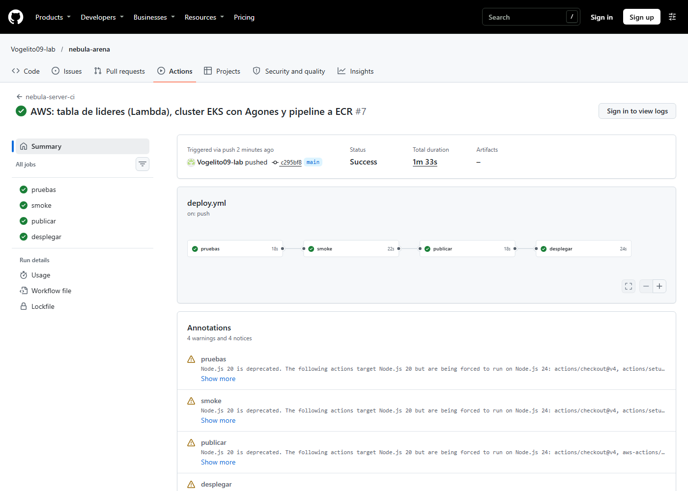

# Práctica 3.2 — Pipeline CI/CD con GitHub Actions

## Introducción

Cada vez que cambia el código del servidor hay que probarlo, construir la imagen,
subirla al registro y actualizar los servidores de juego. Hacerlo a mano es lento
y es fácil equivocarse; por ejemplo, subir una versión que no pasó las pruebas.
En esta práctica automatizamos todo ese camino con GitHub Actions, de forma que un
*push* a `main` termine con la flota usando la imagen nueva, sin cortar partidas.

## Objetivo

Construir un pipeline que pruebe el código, publique la imagen del servidor
etiquetada con el commit y actualice la flota de Agones, y explicar cómo se
regresa a la versión anterior.

## Lo que hicimos

### 1. Escribir el workflow

Creamos `.github/workflows/deploy.yml` con cuatro trabajos encadenados. Si uno
falla, los siguientes no corren, así que una prueba en rojo nunca llega a publicar
una imagen:

1. **pruebas:** corre las pruebas de pytest del servidor, del matchmaker y de la
   tabla de líderes.
2. **smoke:** construye la imagen de Docker, levanta el contenedor y juega una
   partida de 10 jugadores contra él. Falla si el servidor baja de 19 ticks por
   segundo (95 % de los 20 esperados).
3. **publicar:** sube `nebula-server` y `matchmaker` a Amazon ECR con el SHA del
   commit como etiqueta.
4. **desplegar:** actualiza la flota y el matchmaker en el clúster EKS con la
   imagen nueva y espera a que haya servidores `Ready` con esa versión.

En un *pull request* solo corren `pruebas` y `smoke`; publicar y desplegar ocurren
únicamente con *push* a `main`.

### 2. Primera corrida en GitHub

El 5 de noviembre subimos el repositorio a GitHub. En la primera corrida pasaron
`pruebas` y `smoke`, y los dos últimos trabajos se omitieron porque todavía no
había nube. Planeábamos usar Google Cloud como en el material, pero la cuenta nos
pidió un prepago, así que usamos la variante de AWS que también trae el material
(`configure-aws-credentials`, `amazon-ecr-login`, ECR y EKS).

### 3. Darle permisos a GitHub sin darle de más

Lo ideal era OIDC, sin llaves guardadas, y lo dejamos escrito en Terraform. Al
aplicarlo, AWS lo rechazó: la cuenta del plan gratuito tiene una política de la
organización que niega `iam:CreateOpenIDConnectProvider`. Como alternativa
creamos un usuario IAM, `nebula-github`, que solo puede subir imágenes a sus dos
repositorios de ECR y consultar el clúster. Dentro de Kubernetes solo puede
modificar la flota y el matchmaker. Su llave se guardó únicamente en los secretos
de GitHub.

### 4. Corrida completa en AWS

El 9 de noviembre, con el clúster de la práctica 3.3 encendido, hicimos *push* a
`main`. Los cuatro trabajos terminaron en verde en **1 minuto 33 segundos**:

| Trabajo | Duración | Resultado |
|---|---|---|
| pruebas | 18 s | correcto (107 pruebas) |
| smoke | 22 s | correcto |
| publicar | 18 s | correcto |
| desplegar | 24 s | correcto |

Después revisamos el clúster: los tres servidores de la flota ya usaban la imagen
etiquetada con el commit `c295bf8…`. Como ECR tiene etiquetas inmutables, nadie
puede sobrescribir esa versión, y cada servidor se puede rastrear a su commit.

<!-- consola: ../../entrega/evidencias/3.2-pipeline/01-ejecucion-pipeline.txt | 1-17 | Resumen de la corrida y kubectl get gameservers después del despliegue: los 3 servidores Ready usan la imagen etiquetada con el SHA del commit. El número de cuenta está tapado. -->

### 5. Comprobar que actualizar no corta partidas

Antes de la nube lo probamos en un clúster local (kind): cambiamos la flota de la
versión 1.0 a la 1.1 mientras un servidor tenía una partida. Agones reemplazó solo
los servidores libres (`Ready`); el que tenía partida (`Allocated`) siguió con la
versión anterior hasta terminar y llamar a `/shutdown`. En unos 50 segundos los
tres servidores ya estaban en 1.1.

## Pregunta: ¿cómo haríamos rollback a la versión anterior?

Cada versión es una imagen inmutable en ECR etiquetada con el SHA de su commit,
así que volver atrás es apuntar la flota a la etiqueta anterior. Hay dos formas.
La primera es revertir el commit (`git revert` y *push*): el pipeline vuelve a
probar, publica el código anterior y lo despliega, y queda registro en el
historial. La segunda, para una emergencia, es no esperar al pipeline y cambiar la
imagen de la flota directamente a la etiqueta anterior, que sigue guardada en ECR
(`kubectl patch fleet nebula-fleet` con `nebula-server:<sha-anterior>`). En
cualquiera de los dos casos Agones solo reemplaza los servidores libres: las
partidas que empezaron con la versión mala terminan normalmente, y solo las
partidas nuevas usan la versión anterior.

## Conclusión

El pipeline convirtió el despliegue en un *push*: en minuto y medio el código
pasa las pruebas, se juega una partida de prueba contra el contenedor, se publica
y llega a la flota sin cortar a nadie. Lo más útil fue el trabajo `smoke`, porque
prueba la imagen real y no solo el código. También aprendimos que las
restricciones de la cuenta (OIDC bloqueado) obligan a buscar alternativas seguras,
como un usuario con permisos mínimos.
