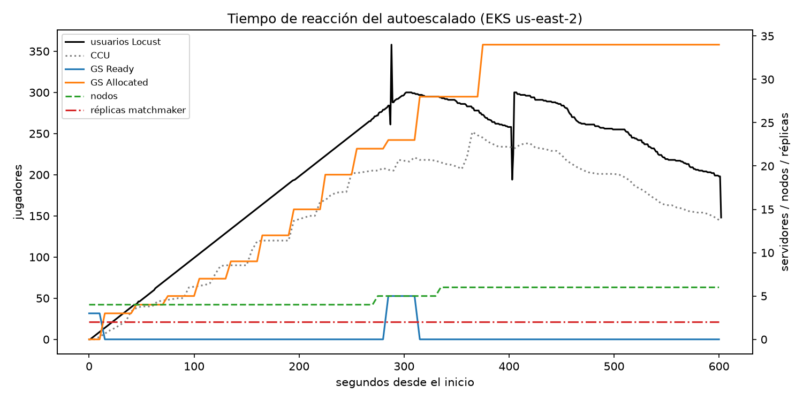
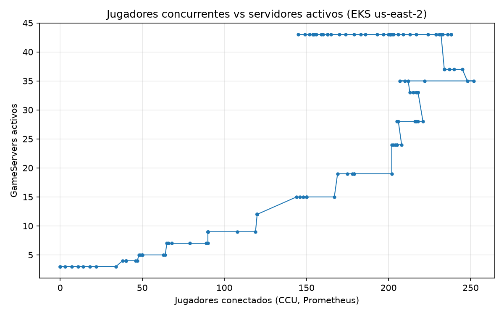
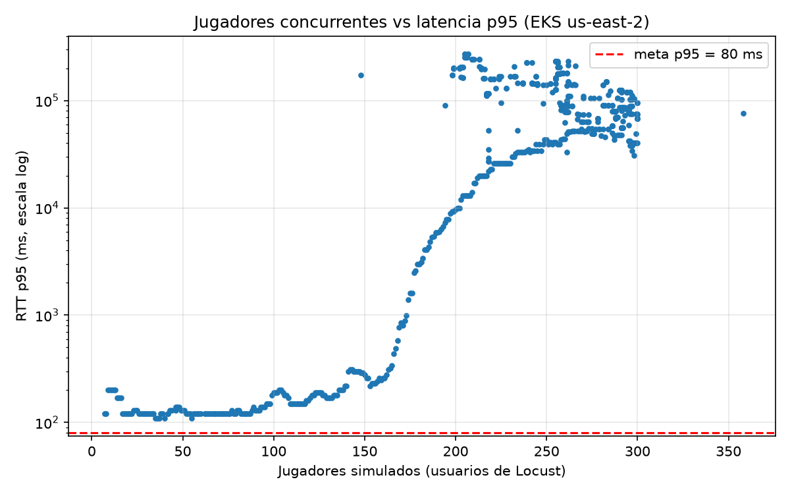

# Práctica 3.4 — Autoescalado, métricas y simulación de jugadores

## Introducción y objetivo

Un juego en línea tiene horas tranquilas y horas pico, así que la plataforma debe
crecer y encogerse sola. En esta práctica pusimos a escalar las tres capas del
sistema, las medimos con Prometheus y Grafana, y simulamos jugadores con Locust
para saber cuánto aguanta un nodo, qué tan rápido reacciona el escalado y qué
configuración conviene.

## Lo que hicimos

Configuramos las tres capas: la **flota** con un FleetAutoscaler de Agones
(`bufferSize` de 20 % y mínimo 3 servidores), el **matchmaker** con un HPA por CPU
y los **nodos** con el Cluster Autoscaler (de 2 a 6 `m7i-flex.large`). Cada
servidor reserva 250m de CPU. El 9 de noviembre, en EKS (us-east-2), corrimos
desde la laptop una rampa de **300 jugadores**, uno nuevo por segundo, durante 10
minutos, y seguimos todo en el tablero de Grafana. Al terminar generamos las tres
gráficas con nuestro script `loadtest/analizar.py`, que junta los datos de Locust y
de Prometheus.

Antes lo ensayamos en un clúster local, y ahí encontramos una falla que
corregimos: el servidor llamaba a `/ready` una sola vez y, si Agones aún no estaba
listo, se quedaba atorado y la flota dejaba de crecer.

## Las tres gráficas

## Resultados

**Capacidad máxima medida:** llegamos a **252 jugadores al mismo tiempo** con 6
nodos, es decir, **unos 42 jugadores por nodo** (6 servidores por nodo × ~7
jugadores). Lo que limitó fue la reserva de 250m de CPU por servidor, no el
servidor: su tick p99 se quedó en 2.5 ms o menos (el 5 % de los 50 ms
disponibles), mantuvo 20 ticks por segundo, y la CPU máxima de un nodo fue de 74 %.
A partir de ~250 jugadores los servidores nuevos ya no cabían en los 6 nodos y el
matchmaker respondió "sin servidores" (200 de 234 asignaciones).

**Tiempo de reacción del escalado:**

| Capa | Antes | Pico | Reacción |
|---|---|---|---|
| Flota (FleetAutoscaler) | 3 servidores | 37 (34 en partida) | 43 s hasta el primer escalado |
| Matchmaker (HPA) | 2 réplicas | 2 | no hizo falta: CPU de 2–3 % |
| Nodos (Cluster Autoscaler) | 4 | 6 | ~1 minuto por nodo (4→5 y 5→6) |

**Latencia:** hasta 164 jugadores, p50 de 120 ms y p95 de 320 ms. Con más de 200
jugadores subió a segundos; como el servidor seguía a 20 Hz, lo más probable es
que se saturara la laptop que generaba la carga (**no lo comprobamos**). La meta de
p95 < 80 ms no se puede cumplir desde Colima: la latencia base a Ohio ya es de
106 ms sin carga.

**Espectadores (cálculo, no medición):** con la fórmula del material, 20,000
espectadores a 1080p (6,000 kbps) durante una hora generan
20,000 × 6,000 × 3,600 / (8 × 10⁶) = **54,000 GB ≈ 54 TB**. Con las tarifas de
CloudFront para Estados Unidos, México y Canadá (API de precios de AWS, publicada
el 19 de octubre de 2026): 10,240 GB × 0.085 + 40,960 GB × 0.080 + 2,800 GB × 0.060
≈ **USD 4,315 por esa hora** (antes del TB gratis del mes). Por eso el video se
sirve desde una CDN, nunca desde los servidores de juego.

**No medido:** la rampa de 1,000 jugadores, el pico de 1× a 10× y los 500
espectadores. 1,000 jugadores necesitan unos 24 nodos, más de lo que alcanzaban
nuestros créditos, y para los espectadores faltó montar la CDN.

## Recomendación de configuración

| Parámetro | Ahora | Recomendado | Por qué (datos) |
|---|---|---|---|
| `bufferSize` | 20 %, mínimo 3 | **8 servidores fijos** (o 20 % con `minReplicas: 8`) | La flota pasó el **93 % de la rampa sin servidores libres**. Llegaban 6 servidores por minuto de jugadores (1 jugador/s) y un nodo nuevo tarda ~1 min, más el arranque del servidor: hacen falta unos 7–8 libres para cubrir ese minuto. Cuestan ~2 vCPU, un nodo (USD 0.096/h). |
| Tipo de máquina | `m7i-flex.large` | **Mantenerla**, y bajar la reserva por servidor de 250m a **100m** | El servidor usa ~5 % de un núcleo (tick de 2.5 ms cada 50 ms), así que 100m aún deja el doble de margen. Podría duplicar los jugadores por nodo (de ~42 a ~80 o más). **Hay que confirmarlo con otra rampa.** |
| Mínimo de nodos | 2 | **2** | En reposo sostienen Agones, el monitoreo y el buffer por USD 0.34/h. Subir el mínimo solo conviene antes de un pico anunciado. |
| Máximo de nodos | 6 | **Según el pico esperado:** ~24 para 1,000 jugadores con 250m (unos 12 si se duplica la capacidad por nodo) | Lo que nos detuvo fue el máximo de 6 nodos, no el código. |

## Conclusión

Las tres capas escalaron solas: la flota pasó de 3 a 37 servidores y el clúster de
4 a 6 nodos. Medimos unos 42 jugadores por nodo, 43 segundos de reacción de la
flota y ~1 minuto por nodo. El cuello de botella no fue el servidor sino la reserva
de CPU y el buffer pequeño, y por eso las dos recomendaciones principales son un
buffer de 8 servidores y una reserva de CPU más baja.
