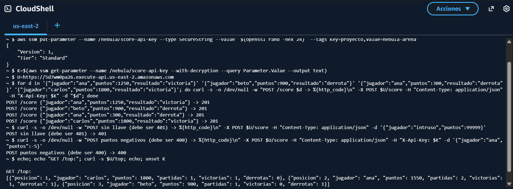

# Práctica 3.5 — Tabla de líderes serverless

## Introducción

Al terminar cada partida, el servidor tiene que guardar los puntos de los
jugadores en algún lugar, y el juego tiene que mostrar el top. Para eso no vale la
pena tener una máquina encendida todo el día: la tabla se usa a ratos. La opción
*serverless* cobra solo por cada petición y escala sola. En esta práctica hicimos
la tabla de líderes con Lambda, API Gateway y DynamoDB, la sometimos a una prueba
de carga y comparamos su costo con el de una máquina virtual.

## Objetivo

Recibir el resultado de cada partida y mantener el top global sin administrar
servidores, medir su comportamiento con carga y comparar el costo con una VM
pequeña encendida todo el mes.

## Lo que hicimos

### 1. La función y sus pruebas

Escribimos la función en Python 3.12 (`serverless/aws/lambda_function.py`) con
la misma API que la versión de Cloud Run del material:

- `POST /score` registra el resultado de una partida.
- `GET /top` devuelve el top 10.
- `GET /jugador/{id}` devuelve las estadísticas de un jugador.

Los puntos se suman con una operación atómica de DynamoDB (`ADD`), como en el
material, para que dos partidas que terminan al mismo tiempo no se pisen. Las
escrituras exigen una llave (`X-Api-Key`), que guardamos en SSM Parameter Store
como SecureString, fuera del código y de Terraform. La Lambda solo conoce el
nombre del parámetro. Escribimos 20 pruebas y todas pasaron.

### 2. Desplegarla con Terraform

Con Terraform creamos 13 recursos: la tabla de DynamoDB (cobro por uso), la
Lambda, su rol con permisos mínimos (solo su tabla, sus logs y su parámetro), la
API de API Gateway con límite de peticiones y los logs con 7 días de retención.

<!-- consola: ../../entrega/evidencias/3.5-tabla-lideres/02-terraform-apply.txt | 314-319 | Final del terraform apply de la tabla de líderes: 13 recursos creados y la URL pública. -->

### 3. Probar la URL

Desde AWS CloudShell creamos la llave y probamos la URL con los `curl` del
material. Registramos 4 partidas (respuesta 201), comprobamos que sin llave se
rechaza (401) y que no acepta puntos negativos (400), y consultamos el top:

También leímos la tabla desde la PC, fuera de AWS. La primera lectura tardó 149 ms
y la mediana de 20 lecturas fue de 125 ms:

<!-- consola: ../../entrega/evidencias/3.5-tabla-lideres/04-lecturas-desde-pc.txt | todo | Lecturas desde la PC, fuera de AWS: GET /top, GET /jugador/ana y los tiempos de 20 lecturas. -->

### 4. Prueba de carga y lo que encontramos

Con Locust lanzamos desde la PC 500 usuarios durante 5 minutos: 80 % de lecturas
del top y 20 % de escrituras. El resultado fue malo: de unas 440 peticiones por
segundo solo se atendían unas 35. Al revisar la métrica de concurrencia en
CloudWatch vimos la causa:

<!-- consola: ../../entrega/evidencias/3.5-tabla-lideres/06-carga-antes_cloudwatch.txt | todo | Métrica de concurrencia de la Lambda en CloudWatch durante la prueba, ANTES de la mejora: la concurrencia máxima se quedó en 10, el límite de la cuenta. -->

1. La cuenta nueva solo permite **10 Lambdas ejecutándose al mismo tiempo**, y cada
   `GET /top` recorría toda la tabla (`scan`) en unos 50 ms.
2. Además, el límite que habíamos puesto en API Gateway (100 peticiones por
   segundo) rechazaba otra parte con error 429.

Hicimos dos mejoras: una **caché del top de 2 segundos** en cada Lambda (un top
con 2 segundos de retraso está bien para una tabla de líderes) y subimos el límite
de API Gateway a 1000 peticiones por segundo. Repetimos la misma prueba:

<!-- consola: ../../entrega/evidencias/3.5-tabla-lideres/07-carga-despues_cloudwatch.txt | todo | Las mismas métricas DESPUÉS de la mejora, con el resumen de Locust. -->

| | Antes | Después |
|---|---|---|
| Peticiones atendidas con éxito | ~35 por segundo | **~99 por segundo** |
| Errores 429 (API Gateway) | 102,607 | **0** |
| Duración promedio de la Lambda | 50 ms | **13 ms** |
| Latencia p50 / p95 / p99 | 75 / 130 / 260 ms | 77 / 110 / 210 ms |

Lo atendido se triplicó. El límite que queda es la cuota de 10 Lambdas de la
cuenta nueva; lo normal en AWS es 1000 y se pide en *Service Quotas*.

### 5. Costo: serverless contra una VM

Con los precios de lista de AWS (9 de noviembre), para el escenario del material
de 5 millones de consultas al mes:

| Concepto | Cálculo | USD al mes |
|---|---|---|
| Lambda, peticiones | (5 M − 1 M gratis) × 0.20 por millón | 0.80 |
| Lambda, cómputo | 16,250 GB-s, dentro de los 400,000 gratis | 0.00 |
| API Gateway | 5 M × 1.00 por millón | 4.00 – 5.00 |
| DynamoDB, escrituras | 1 M × 0.625 por millón | 0.63 |
| DynamoDB, lecturas | con la caché, casi ninguna | < 1 |
| **Total serverless** | | **≈ 6 – 7** |
| VM pequeña encendida 24/7 | máquina, IP pública y disco | ≈ 15 – 20 |

Además, sin jugadores la opción serverless cuesta casi cero, mientras que la VM
cuesta lo mismo aunque nadie juegue.

## Conclusión

La tabla de líderes funcionó desde el primer día sin administrar ningún servidor,
y es más barata que una VM para este uso. La prueba de carga fue lo más valioso:
sin ella no habríamos descubierto el límite de 10 Lambdas ni que recorrer toda la
tabla en cada consulta era el problema. Con una caché sencilla triplicamos la
capacidad. Para producción pediríamos la cuota de concurrencia y cambiaríamos el
`scan` por un índice ordenado por puntos.
