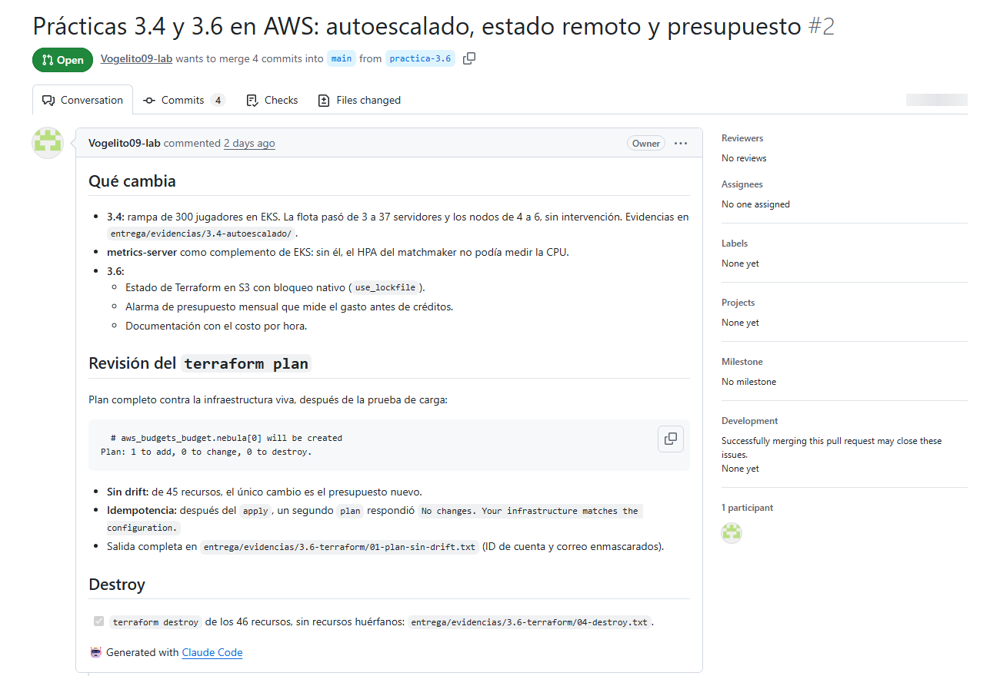

# Práctica 3.6 — Infraestructura como código

## Introducción

En las prácticas anteriores la nube tenía muchas piezas: red, clúster, nodos,
Agones, monitoreo, registros de imágenes, permisos y la tabla de líderes. Crear
todo eso a mano en la consola es lento, no se puede repetir igual y es fácil
olvidar algo encendido que siga cobrando. Con Terraform describimos toda la
infraestructura en archivos de código: un comando la crea, otro la borra, y los
cambios se revisan antes de aplicarlos.

## Objetivo

Crear con Terraform todo el entorno de Nebula Arena, revisar el plan antes de
aplicarlo, comprobar que el clúster funciona y destruirlo al terminar sin dejar
recursos que sigan cobrando.

## Lo que hicimos

### 1. Escribir la infraestructura

Usamos la variante de AWS del material, en la carpeta `infra-aws/`. Separamos la
infraestructura por archivos:

| Archivo | Qué crea |
|---|---|
| `red.tf` | La red, dos subredes públicas y los puertos 7000–8000 para las partidas |
| `cluster.tf` | El clúster EKS, los nodos (2 a 6) y los permisos del Cluster Autoscaler |
| `complementos.tf` | Agones, el Cluster Autoscaler, Prometheus y Grafana con Helm |
| `registro.tf` | Los repositorios de imágenes en ECR |
| `tabla_lideres.tf` | La tabla de líderes de la práctica 3.5 |
| `github.tf` | El usuario del pipeline de la práctica 3.2 |
| `presupuesto.tf` | Una alarma de costos |

En total son **46 recursos**. Todo lleva la etiqueta `proyecto=nebula-arena`, para
poder encontrarlo después.

### 2. Estado remoto

Terraform guarda en un archivo de estado qué recursos creó. Lo movimos a un
bucket de S3 privado, versionado y cifrado, con bloqueo para que dos personas no
apliquen cambios al mismo tiempo. Usamos el bloqueo nativo de S3 (`use_lockfile`,
desde Terraform 1.10), así que no hizo falta la tabla de DynamoDB del material.

### 3. Alarma de costos

Con el plan gratuito todo se descuenta de los créditos y el costo siempre aparece
en cero, así que una alarma normal nunca avisaría. Creamos un presupuesto que mide
el costo **antes** de créditos, con un límite de USD 15 al mes y avisos por correo
al 50 % y al 80 % del gasto, y al 100 % del pronóstico.

### 4. Revisar el plan antes de aplicar

Siempre trabajamos con `terraform plan -out` y después aplicamos ese archivo, para
que se aplique exactamente lo que revisamos. Después de la prueba de carga de la
3.4 corrimos el plan contra la infraestructura viva para buscar *drift* (cambios
hechos a mano fuera de Terraform). No encontró ninguno; lo único nuevo era el
presupuesto que acabábamos de agregar:

<!-- consola: ../../entrega/evidencias/3.6-terraform/01-plan-sin-drift.txt | 1-2,62-64,128-128 | terraform plan contra la infraestructura viva, con el estado remoto en S3: sin drift; lo único nuevo es el presupuesto. -->

Lo aplicamos y corrimos un segundo plan para comprobar que Terraform es
idempotente, es decir, que si no cambia nada en el código no propone cambios:

<!-- consola: ../../entrega/evidencias/3.6-terraform/02-idempotencia.txt | todo | Segundo terraform plan: No changes. -->

Los cambios los revisamos en el *pull request* #2 de GitHub, de la rama
`practica-3.6` hacia `main`. En la descripción pegamos la salida del plan y
explicamos qué significa antes de aplicarla:

### 5. El clúster funcionando

Revisamos que lo que creó Terraform estuviera funcionando: el clúster activo, los
nodos listos, Agones, el autoescalador, el monitoreo, la flota con sus 3
servidores libres y el matchmaker con su balanceador:

<!-- consola: ../../entrega/evidencias/3.6-terraform/03-cluster-funcionando.txt | 1-10,26-35 | Clúster creado por Terraform funcionando: EKS ACTIVE, 5 nodos Ready, la flota con 3 servidores Ready, el HPA y el balanceador del matchmaker. -->

### 6. Destruir todo sin dejar huérfanos

Primero borramos el balanceador del matchmaker y la flota, porque esos los crea
Kubernetes y no Terraform. Si no, el balanceador se queda huérfano y bloquea el
borrado de la red. Después corrimos `terraform plan -destroy` (46 recursos) y lo
aplicamos. El `destroy` nos encontró dos fallas, que corregimos en el código:

- **Orden de borrado:** Terraform borró la salida a internet antes que Agones, y el
  desinstalador de Agones ya no pudo descargar su imagen. Ahora los nodos dependen
  de esa ruta, así que la ruta se borra al final.
- **Usuario de GitHub:** la política de la cuenta gratuita no deja que Terraform
  borre el usuario con `force_destroy`. Le quitamos esa opción y borramos su llave
  con la línea de comandos antes del `destroy`.

Al final se destruyeron **46 de 46 recursos** y revisamos la cuenta servicio por
servicio:

<!-- consola: ../../entrega/evidencias/3.6-terraform/04-destroy.txt | todo | Evidencia del terraform destroy y la revisión de recursos huérfanos en us-east-2. La instancia t3.micro que aparece es anterior al proyecto. -->

Solo dejamos a propósito el bucket del estado y la llave en SSM, que cuestan
prácticamente nada y permiten volver a crear todo con un comando.

## Resultados: costo por hora

Consultamos los precios con la API de precios de AWS (us-east-2, 9 de noviembre):

| Recurso | En reposo (2 nodos) | En el pico (6 nodos) |
|---|---|---|
| Plano de control de EKS | 0.100 | 0.100 |
| Nodos m7i-flex.large (USD 0.096 por hora c/u) | 0.192 | 0.575 |
| IPs públicas | ≈ 0.020 | ≈ 0.040 |
| Balanceador del matchmaker | 0.025 | 0.025 |
| **Total (USD por hora)** | **≈ 0.34** | **≈ 0.74** |

En el pico de la 3.4 (252 jugadores) eso da **USD 0.003 por jugador y hora**. En
reposo el clúster cuesta unos USD 8 al día, por eso lo destruimos al terminar
cada sesión.

## Conclusión

Terraform hizo que toda la plataforma se pudiera crear, revisar y borrar con
comandos, sin pasos a mano. Revisar el plan antes de aplicar evitó sorpresas, y el
plan sin drift y el segundo plan sin cambios demostraron que el código y la nube
coincidían. Lo que más nos enseñó fue el `destroy`: borrar también se tiene que
probar, porque encontró dos fallas reales que habrían dejado recursos cobrando.
