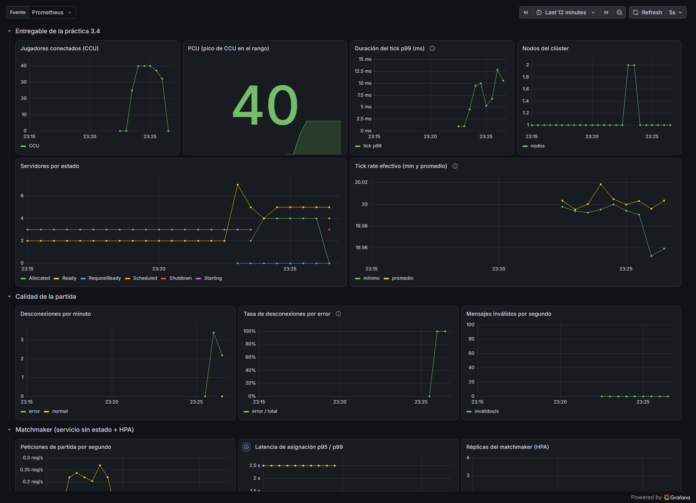

# Guion de la presentación final

## Introducción

El material pide una presentación de 10 minutos con una demostración en vivo del
autoescalado. Este guion dice qué vamos a decir en cada bloque, cuánto dura y qué
enseñamos en pantalla. Como destruimos todo en AWS para no gastar créditos, la demo
la hacemos en vivo en la laptop, con el mismo juego, Agones, Prometheus y Grafana
en un clúster local (kind), sin costo. Lo que no se puede ver en la laptop (la capa
de nodos) lo enseñamos con las capturas de la prueba en AWS.

## Bloques de la presentación

| Minuto | Bloque | Qué decimos y qué enseñamos |
|---|---|---|
| 0:00–0:45 | **El problema** | Un juego en línea tiene picos: 100 jugadores a las 3 de la tarde y 1,000 a las 9 de la noche. Pagar servidores para el pico todo el día es caro, y quedarse corto deja a los jugadores sin partida. Nuestro objetivo: que la plataforma crezca y se encoja sola, y saber cuánto aguanta y cuánto cuesta. |
| 0:45–1:30 | **El juego** | 10 segundos de una partida 5 contra 5. "El juego es el caso de estudio; lo que evaluamos es la infraestructura." |
| 1:30–3:00 | **Arquitectura** | El diagrama del reporte: matchmaker, Agones y servidores de partida; Prometheus y Grafana; la tabla de líderes serverless; el pipeline a ECR; Terraform. Explicamos las tres capas de escalado: flota, pods y nodos. |
| 3:00–6:00 | **Demo en vivo** | Ver la sección siguiente. |
| 6:00–7:30 | **Resultados** | La rampa de 300 jugadores en EKS: la flota pasó de 3 a 37 servidores y los nodos de 4 a 6; máximo de 252 jugadores, unos 42 por nodo; la flota reaccionó en 43 segundos y cada nodo tardó ~1 minuto. Enseñamos la gráfica de reacción y la captura de Grafana. |
| 7:30–8:30 | **Costos** | Clúster: USD 0.34 por hora en reposo y 0.74 en el pico, **USD 0.003 por jugador y hora**. Bots: USD 0.60 por hora para 2,000. Espectadores: 20,000 son 54 TB por hora. Tabla de líderes: ≈ USD 6–7 al mes contra 15–20 de una VM. |
| 8:30–9:30 | **Lo que aprendimos** | Las fallas que encontraron las pruebas: `/ready` una sola vez, `SIGTERM` ignorado, EKS sin metrics-server, el límite de 10 Lambdas y el orden del `destroy`. La GPU fue 68 % más lenta que la CPU para un bot pequeño. |
| 9:30–10:00 | **Cierre** | "Todo lo que vieron en AWS se crea y se destruye con un comando de Terraform." Preguntas. |

## Demo en vivo (3 minutos)

**Antes de la clase (10 minutos antes):** detener otros proyectos de Docker, porque
Docker solo tiene 4 GB, y encender la demo con el script:

```
.\k8s\local\demo.ps1 -Encender
```

El script enciende el clúster, aplica el autoescalador con 5 servidores libres de
reserva (la recomendación del reporte de la 3.4) y abre Grafana, que no pide
contraseña.

**En la demo:**

1. Grafana en pantalla completa: jugadores conectados, servidores por estado y tick
   rate.
2. Arrancamos la carga: `.\k8s\local\demo.ps1 -Carga` (40 jugadores, uno por
   segundo, 3 minutos).
3. Mientras sube explicamos: los jugadores entran, los servidores `Ready` pasan a
   `Allocated` y el FleetAutoscaler crea más para mantener 5 libres. En el ensayo la
   flota pasó de 5 a 9 servidores, nunca se quedó sin servidores libres y el tick
   rate se mantuvo en 20.
4. Al terminar, el script muestra `kubectl get fleet` y `kubectl get gameservers`.
5. Para la capa de nodos, que la laptop no tiene, enseñamos la captura de la rampa
   de 300 jugadores en AWS (de 4 a 6 nodos).

**Al terminar:** `.\k8s\local\demo.ps1 -Apagar`.

**Respaldo:** si algo falla, enseñamos la captura del ensayo
(`entrega/evidencias/demo-local/grafana-demo-40-jugadores.png`) y las de AWS.



## Diapositivas

1. Título y equipo.
2. El problema.
3. El juego (captura).
4. Arquitectura (diagrama).
5. Las tres capas de escalado.
6. Demo (solo el título; cambiamos a Grafana).
7. Resultados (2 gráficas).
8. Costos (tabla).
9. Lo que aprendimos y recomendaciones.
