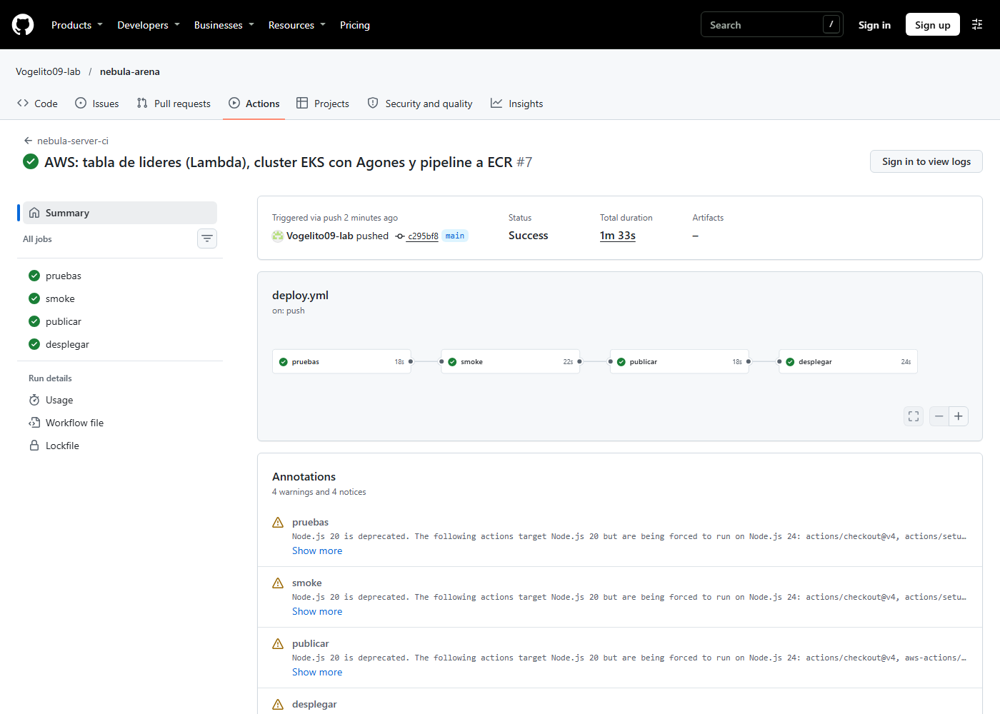
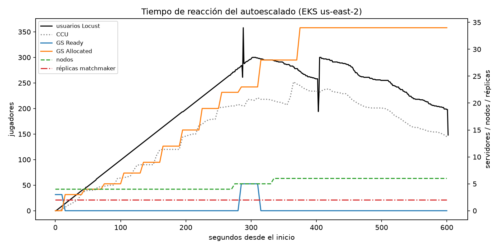

# Reporte técnico — Nebula Arena en la nube

## Introducción

Nebula Arena es un juego de naves 5 contra 5 en 3D, con bots, que construimos
como caso de estudio para la Unidad 3. Lo que se evalúa no es el juego sino la
infraestructura: que la plataforma pueda recibir jugadores, crecer sola cuando
llegan más, medir cuánto aguanta y cuánto cuesta, y desaparecer por completo al
terminar. Todo lo desplegamos y probamos en AWS (región us-east-2) el 9 de
noviembre de 2026, y después lo destruimos con Terraform. Usamos AWS porque la
cuenta de Google Cloud nos pidió un prepago; el material trae la variante de AWS
para cada práctica.

Todas las cifras de este reporte salen de nuestras mediciones o de precios
oficiales. Lo que no medimos lo decimos explícitamente.

## Arquitectura

```
 Jugadores ──HTTP──▶ Matchmaker (Deployment + HPA, balanceador de AWS) ──GameServerAllocation──▶ Agones
     │                                                                                       │
     └────────────── WebSocket :7000-8000 (IP pública del nodo) ──▶ GameServer (pod) ◀────────┘
                                                                   │  server.py 20 Hz
                                                                   │  /metrics ──▶ Prometheus ──▶ Grafana
                                                                   └─ fin de partida ─POST /score─▶ API Gateway ─▶ Lambda ─▶ DynamoDB
 GitHub Actions: pruebas → smoke → publicar (ECR) → desplegar (flota y matchmaker en EKS)
 Terraform: red, EKS + nodos + Cluster Autoscaler, ECR, IAM, tabla de líderes, Agones, monitoreo, presupuesto
```

El jugador le pide partida al **matchmaker**, que le pide a **Agones** un
servidor libre y le devuelve la dirección. El jugador se conecta directo al
**servidor de partida**, que es autoritativo: decide posiciones y daño a 20 ticks
por segundo, así que el cliente no puede hacer trampa. Al terminar la partida, el
servidor manda los puntos a la **tabla de líderes** serverless. Prometheus lee
las métricas de cada servidor y Grafana las muestra.

Tomamos tres decisiones importantes:

- **Red pública sin NAT Gateway:** los servidores de juego necesitan IP pública de
  todos modos, y así ahorramos unos USD 33 al mes.
- **Drenado:** el servidor solo llama a `/shutdown` cuando su partida termina, así
  que Agones nunca recicla un servidor con jugadores.
- **Credenciales fuera del código:** Terraform usa credenciales temporales, y la
  llave de la tabla de líderes vive en SSM.

## Lo que hicimos y lo que medimos

**Bots (3.1).** Entrenamos un agente pequeño en Colab y medimos que una vCPU de
nube da entre 2,315 y 2,787 decisiones por segundo. Para 2,000 bots a 10 Hz
hacen falta 12 vCPU, o sea USD 0.60 por hora. La GPU fue 68 % más lenta que la
CPU, porque con una red tan chica copiar los datos cuesta más que calcular. Los
bots del juego son de reglas; el agente sirvió para medir el costo.

**Contenedores y Agones (3.3).** Empaquetamos el servidor en una imagen de 206 MB
y lo desplegamos como flota en EKS. Los 3 servidores estuvieron listos a los 8
segundos. Jugamos una partida real por internet desde Colima con 10 jugadores:

<!-- consola: ../../entrega/evidencias/3.3-cluster-agones/02-partida-real.txt | 3-8,10-12 | Asignación de un servidor por el matchmaker en EKS y partida de 10 jugadores por internet desde Colima. -->

La latencia base fue de 106 ms (p50), que es la distancia de Colima a Ohio.

**CI/CD (3.2).** Con cada *push* a `main`, GitHub Actions prueba el código (107
pruebas), juega una partida de prueba contra el contenedor, publica la imagen en
ECR con el SHA del commit y actualiza la flota. La corrida completa tardó 1 minuto
33 segundos:



Para hacer rollback se apunta la flota a la imagen del commit anterior, que sigue
en ECR. Agones solo reemplaza los servidores libres, así que las partidas en curso
no se cortan.

**Tabla de líderes (3.5).** Lambda, API Gateway y DynamoDB, con escrituras
protegidas por llave. En la prueba de carga con 500 usuarios descubrimos que la
cuenta nueva solo permite 10 Lambdas a la vez. Con una caché del top de 2
segundos pasamos de ~35 a **~99 peticiones atendidas por segundo**.

**Infraestructura como código (3.6).** Terraform crea los 46 recursos con un
comando. El plan contra la nube viva no encontró *drift*, un segundo plan dio
`No changes`, y `terraform destroy` borró los 46 sin dejar nada cobrando.

## Autoescalado: capacidad máxima y tiempo de reacción (3.4)

Corrimos una rampa de 300 jugadores simulados con Locust, uno nuevo por segundo
durante 10 minutos, con un máximo de 6 nodos para cuidar los créditos:



| Capa | Antes | Pico | Tiempo de reacción |
|---|---|---|---|
| Flota (FleetAutoscaler) | 3 servidores | 37 (34 en partida) | 43 s hasta el primer escalado |
| Matchmaker (HPA) | 2 réplicas | 2 | no hizo falta (CPU de 2–3 %) |
| Nodos (Cluster Autoscaler) | 4 | 6 (el máximo) | ~1 minuto por nodo |

- **Capacidad máxima medida:** 252 jugadores al mismo tiempo, unos **42 jugadores
  por nodo** `m7i-flex.large`.
- **El servidor nunca se saturó:** tick p99 de 2.5 ms o menos (5 % de los 50 ms
  disponibles) y 20 ticks por segundo todo el tiempo.
- **El techo fue el máximo de 6 nodos:** a partir de ~250 jugadores los servidores
  nuevos ya no cabían. Con 42 jugadores por nodo, **1,000 jugadores necesitan
  unos 24 nodos**.
- **Latencia:** hasta 164 jugadores, p50 de 120 ms y p95 de 320 ms. Arriba de 200
  subió a segundos. Lo más probable es que la causa fuera la laptop que generaba
  la carga, porque el servidor seguía a 20 Hz; **no lo comprobamos**.

Las pruebas de carga también encontraron fallas reales que corregimos: el
servidor llamaba a `/ready` una sola vez y se quedaba atorado, ignoraba `SIGTERM`
y tardaba 30 segundos en morir, y EKS no traía metrics-server, así que el HPA no
veía la CPU.

**No medido:** la rampa de 1,000 jugadores y el pico de 1× a 10× (necesitan unos
24 nodos y no teníamos créditos para eso), y los 500 espectadores (faltó la CDN).
Para espectadores hicimos el cálculo del material: 20,000 espectadores a 6,000
kbps durante una hora son **54 TB por hora**, que deben salir de una CDN.

## Costos

Precios bajo demanda de AWS en us-east-2, consultados con su API el 9 de
noviembre:

| Concepto | Valor |
|---|---|
| Clúster en reposo (EKS, 2 nodos, IPs y balanceador) | **USD 0.34 por hora** (~USD 8 al día) |
| Clúster en el pico (6 nodos) | **USD 0.74 por hora** |
| **Costo por jugador y hora** (0.74 / 252) | **≈ USD 0.003** |
| 1,000 jugadores (~24 nodos, estimado) | ≈ USD 2.5 por hora |
| Tabla de líderes, 5 millones de consultas al mes | ≈ USD 6–7 al mes serverless, contra ≈ 15–20 una VM |
| Inferencia de 2,000 bots (3.1) | USD 0.60 por hora |
| Gasto real del proyecto, 1 al 9 de noviembre | ≈ USD 3.3 antes de créditos (sin el EKS del día 9, que Cost Explorer aún no mostraba) |

Para controlar el gasto pusimos un presupuesto que mide el costo antes de
créditos, un máximo de nodos y `terraform destroy` al terminar cada sesión.

## Recomendaciones

- **Bajar la CPU reservada por servidor.** El servidor usa ~2.5 ms de sus 50 ms por
  tick; bajar la reserva de 250m a ~100m podría duplicar los jugadores por nodo.
  Hay que confirmarlo con otra rampa.
- **Nodos:** mínimo 2 en reposo y el máximo según el pico esperado (~24 para 1,000
  jugadores con la configuración actual).
- **Buffer de la flota más grande** o escalado programado antes de las horas pico:
  la flota pasó el 93 % de la rampa sin servidores libres.
- **Generar la carga desde la nube**, en la misma región, para separar la latencia
  del generador de la del sistema.
- **Servidores de partida bajo demanda, no Spot**, porque una interrupción corta la
  partida. El entrenamiento de bots sí puede ir en Spot.
- **Tabla de líderes:** pedir más cuota de Lambda y cambiar el `scan` por un índice
  ordenado por puntos.

## Conclusiones

La plataforma funcionó en AWS de punta a punta: el pipeline publica y actualiza
la flota sin cortar partidas, las tres capas escalaron solas con 300 jugadores, la
tabla de líderes atiende unas 99 peticiones por segundo con la cuota mínima, y
todo se crea y se destruye con Terraform. Los límites que encontramos fueron de la
cuenta (región, cuota de Lambda y el tope de nodos que pusimos por costo) y del
generador de carga, no del diseño. Las pruebas cumplieron su propósito, porque
encontraron fallas reales que corregimos antes de que afectaran a jugadores.
